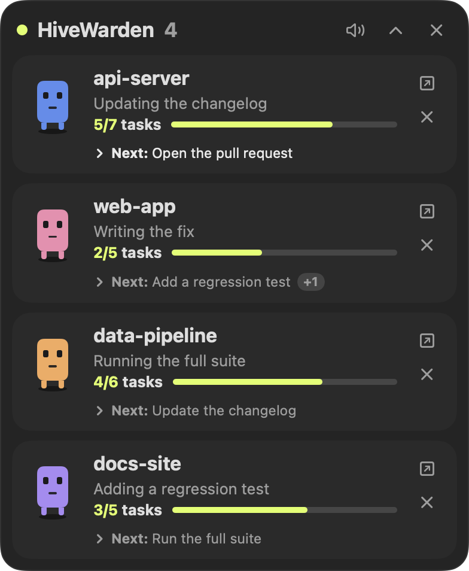
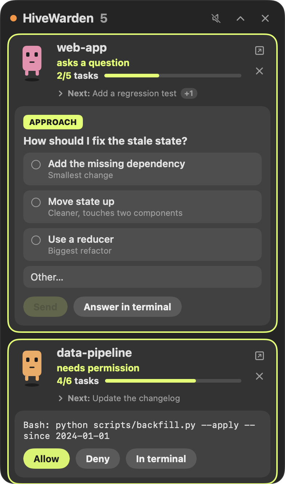

# HiveWarden

**One small floating panel for all your Claude Code agents.** See what each one is
doing and what it plans next, and answer its permission prompts and questions without
hunting through terminal windows.

<p align="center">
  
  
</p>

When you run several `claude` sessions at once, each one can stop and wait for you
without you noticing. HiveWarden sits on top of your windows and shows every session
as a little mascot:

- **What it's doing** — the current step, a progress bar, and the steps still to come.
- **When it needs you** — the row lights up and plays a sound. Click **Allow** or
  **Deny**, or pick an answer, right there. Your editor keeps keyboard focus.
- **Where it lives** — the ↗ button brings the right Terminal or iTerm tab forward.

It runs entirely on your Mac. It talks only to Claude Code on `127.0.0.1` and sends
nothing anywhere else. If HiveWarden isn't running, Claude Code behaves exactly as it
did before.

## Requirements

- macOS 14 (Sonoma) or newer
- [Claude Code](https://claude.com/claude-code)
- Xcode 16 or newer, to build it (there is no downloadable app yet)

## Install

```bash
git clone https://github.com/formakidov/HiveWarden.git
cd HiveWarden
./scripts/build-app.sh
open build/HiveWarden.app
```

Then:

1. Click **Install hooks** in the panel. This adds HiveWarden's entries to
   `~/.claude/settings.json` and keeps a one-time backup next to it
   (`settings.json.hivewarden-backup`).
2. Start a new `claude` session, or send a prompt in one that is already open. It
   shows up in the panel.

To keep it around, drag `build/HiveWarden.app` into `/Applications` (it then shows up in
Launchpad and Spotlight), and turn on **Launch at login** from the menu-bar icon.

Prefer the command line? `build/HiveWarden.app/Contents/MacOS/HiveWarden --install-hooks`
does the same as the button.

## Using it

| You want to | Do this |
|---|---|
| See the full plan and recent steps of an agent | Click its row. The coloured chips at the top switch between agents. |
| See what an agent will do next | Click **Next** under its row. |
| Approve or refuse a command | **Allow** / **Deny** on the card. **In terminal** hands the prompt back to Claude's own dialog. |
| Answer a question | Pick an option (or type under **Other…**) and **Send**. |
| Go to an agent's terminal | The ↗ button. |
| Rename an agent | Right-click its row → **Rename…** |
| Hide the panel | The ✕ in the header. The menu-bar icon brings it back; it also reappears when an agent needs you. |

HiveWarden has a Dock icon (click it to bring the panel back) and a menu-bar icon that holds the settings: alert sound, plan
reporting, hooks, launch at login, the event log, and Quit.

The first time you use ↗ with Terminal or iTerm, macOS asks whether HiveWarden may
control that app. Allow it, or the right window comes forward but not the right tab.

### Good to know

- **Permission cards appear only when Claude would actually ask.** In `auto` or
  `bypassPermissions` mode Claude approves commands itself, so there is nothing to
  show. Use the default mode (Shift+Tab in Claude Code) to see them.
- **Plans come from the agents.** Many Claude Code builds give the agent no todo tool,
  so HiveWarden asks each session, once, to announce multi-step plans with a harmless
  `echo`. That is what fills the progress bar and the **Next** list. It costs one small
  extra command per step. Turn it off with menu bar → **Ask agents to report their
  plan**; without a plan you get a spinner and a step counter instead.
- **Plan approvals stay in the terminal.** The row tells you a plan is waiting and
  takes you there.
- **VS Code and Cursor**: ↗ raises the window that has the project open, not the exact
  terminal tab inside it.

## Uninstall

1. Menu-bar icon → **Remove Claude Code hooks** (or run the app binary with
   `--uninstall-hooks`).
2. Quit HiveWarden and delete the app.
3. Optionally remove its data: `rm -rf ~/Library/Application\ Support/HiveWarden`

## Troubleshooting

- **No agents show up.** Check that the hooks are installed (the panel offers the
  button when they aren't), then send a prompt in your `claude` session.
- **The menu-bar icon is gone.** The app isn't running; open it again. Your agents
  were not affected.
- **Something looks wrong.** Menu bar → **Show event log** lists every event the app
  received and what it answered. Please attach the relevant lines to a bug report.

## How it works

Claude Code [hooks](https://code.claude.com/docs/en/hooks) call a small
shell script on each event. The script forwards the event to a server inside the app,
and for permission requests and questions it waits for your click and hands the answer
back to Claude. [ARCHITECTURE.md](ARCHITECTURE.md) has the design, the security model
and the failure modes.

## Development

```bash
swift test                    # unit tests for the event handling
swift run ClaudeWorkers       # run without bundling
./scripts/demo.sh             # four fake agents, then a permission request and a question
./scripts/demo.sh clear       # remove them again
./scripts/e2e-eof.sh          # checks the answer round trip against the running app
./scripts/e2e-claude.sh       # the same with a real `claude -p` session (uses a little credit)
./scripts/snapshot.sh out.png # render the panel to a PNG
```

The code base is called `ClaudeWorkers`; `HiveWarden` is the product name, set in
`AppInfo.name` and `scripts/build-app.sh`.

The build is ad-hoc signed, which is fine on the Mac that built it. To sign with your
own certificate: `SIGN_ID="Developer ID Application: …" ./scripts/build-app.sh`.

## Contributing

Issues and pull requests are welcome. For anything larger than a fix, open an issue
first so we can agree on the approach. Please run `swift test` before you send a pull
request, and add a test when you change how events are handled.

## License

[MIT](LICENSE). Free to use, change and share.

HiveWarden is an independent project. It is not made or endorsed by Anthropic; "Claude"
and "Claude Code" are Anthropic's trademarks.
